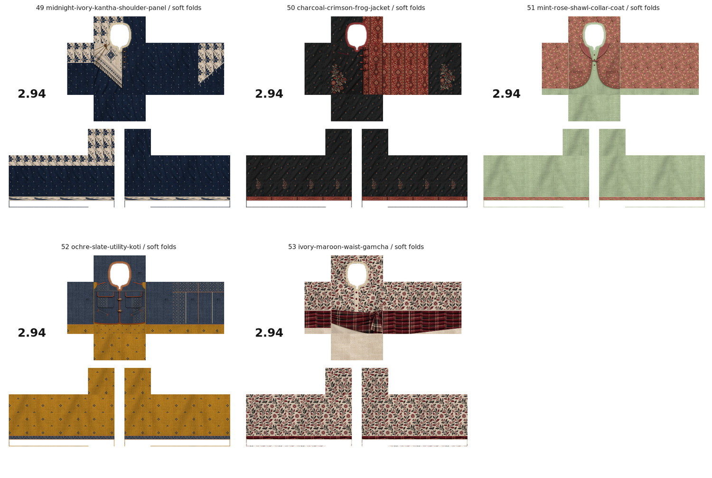
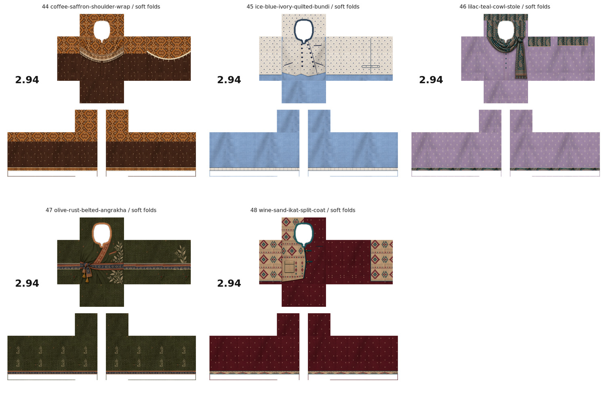
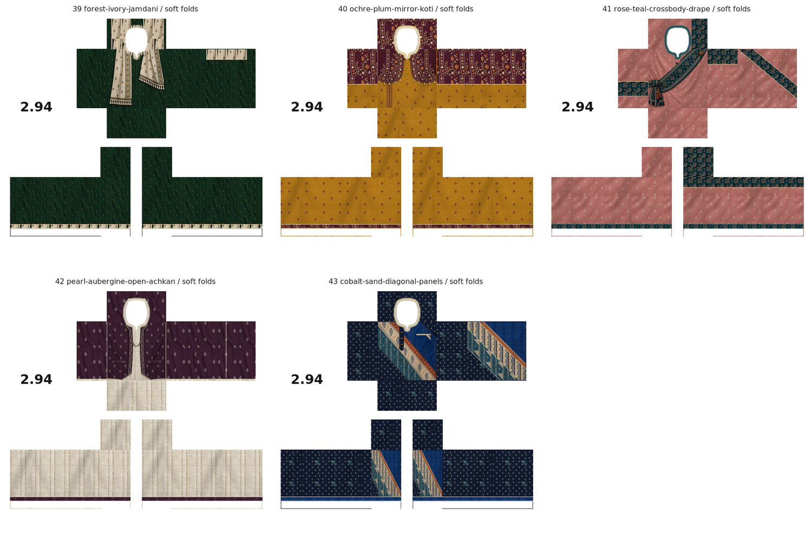
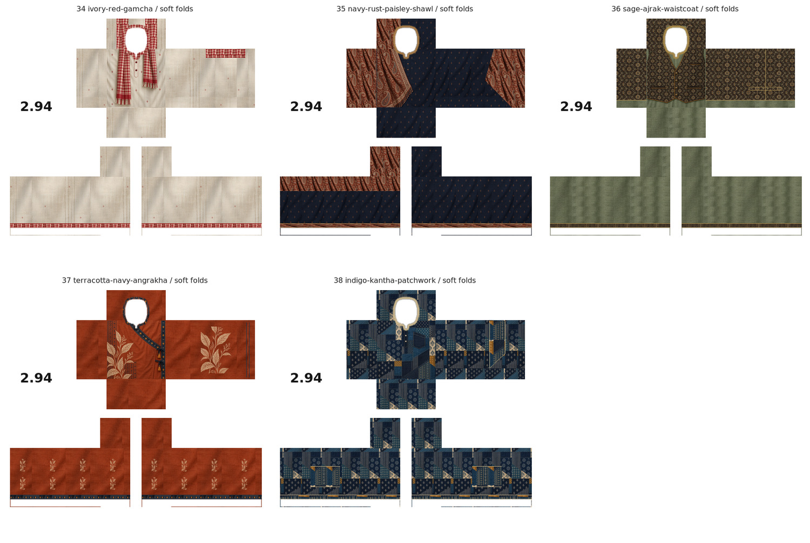
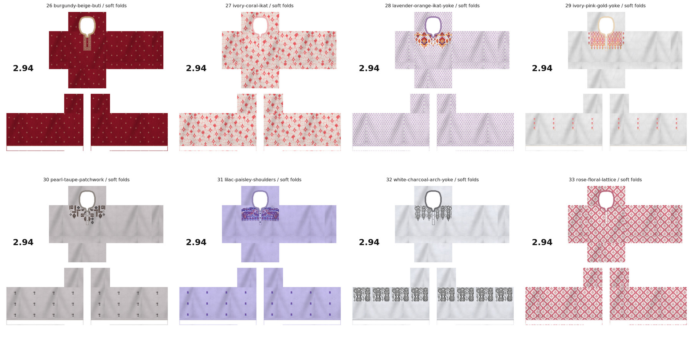
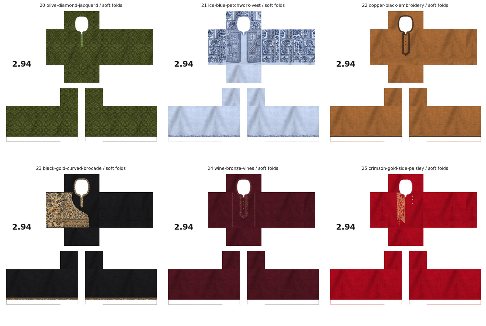
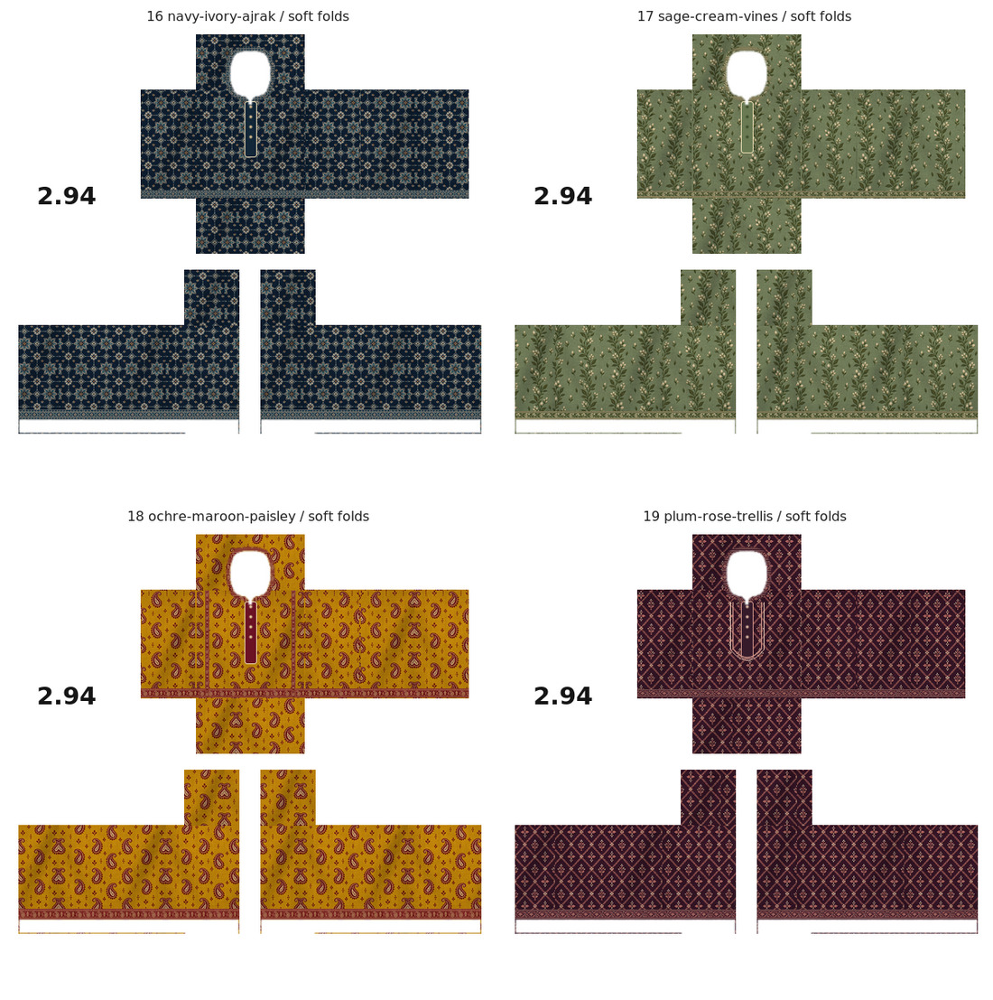
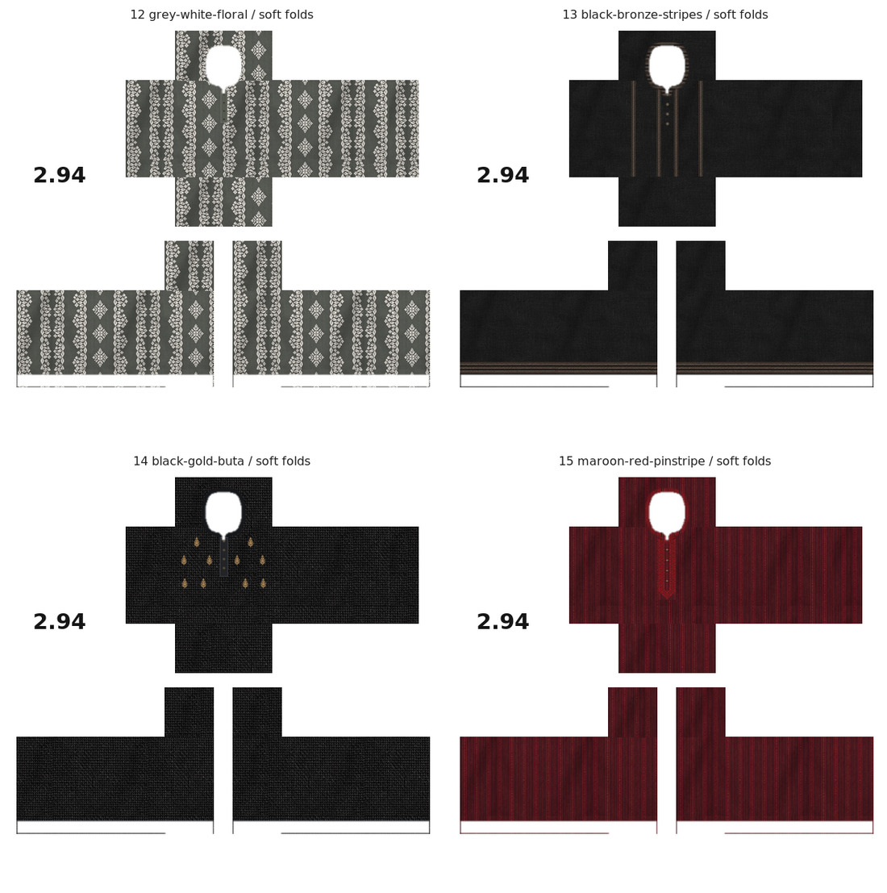

# Roblox Panjabi samples

## Five more original layered styles: 49–53

[Browse five finished PNGs](original-layered-49-53/README.md) · [Download all five as ZIP](original-layered-49-53/five-original-layered-panjabi-designs-49-53.zip)

Midnight/ivory triangular Kantha shoulder cloth; charcoal/crimson brocade jacket with frog closures; mint/rose floral shawl-collar coat; ochre/slate utility koti with flap pockets; ivory/maroon botanical kurta with checked waist gamcha. Distinct layer shapes, fastenings and pockets, with coordinated back, shoulder, side and sleeve details. One matte woven soft-fold PNG per design, using approved 585 × 559 mapping, genuine alpha openings, white unused canvas and `2.94` branding.

Dimensions, exact alpha equality, style-specific material placement and ZIP integrity checked. Not tested in Roblox Studio.

## Five new original styles: 44–48

[Browse five finished PNGs](original-layered-44-48/README.md) · [Download all five as ZIP](original-layered-44-48/five-original-layered-panjabi-designs-44-48.zip)

Coffee/saffron broad Ajrak shoulder wrap; ice-blue/ivory quilted double-breasted bundi; lilac/teal looped paisley stole; olive/rust belted Angrakha with botanical print; wine/sand asymmetric ikat coat panel. Each has its own layering, fastenings, pockets and coordinated back/sleeve details. One matte woven soft-fold PNG per design, using the approved 585 × 559 mapping, genuine alpha openings, white unused canvas and `2.94` logo.

Dimensions, exact alpha equality, style-specific material placement and ZIP integrity verified. Not tested in Roblox Studio.

## Five new layered styles: 39–43

[Browse five finished PNGs](original-layered-39-43/README.md) · [Download all five as ZIP](original-layered-39-43/five-original-layered-panjabi-designs-39-43.zip)

Forest/ivory Jamdani-style stole; ochre/plum cropped embroidered koti with cream mirror-work; rose/teal cross-body sash with knot and fringe; pearl/aubergine long open achkan; cobalt/sand large diagonal panels with wooden toggles. Distinct layering and coordinated back, side and sleeve details. One matte woven soft-fold PNG per design, retaining approved 585 × 559 mapping, genuine alpha openings, white unused canvas and `2.94` logo.

Dimensions, exact alpha equality, style-specific material placement and ZIP integrity checked. Not tested in Roblox Studio.

## Five original layered styles: 34–38

[Browse five finished PNGs](original-layered-34-38/README.md) · [Download all five as ZIP](original-layered-34-38/five-original-layered-panjabi-designs-34-38.zip)

Distinct original outfit treatments: ivory/red checked gamcha with unequal fringed ends; navy/rust paisley shawl wrapping one shoulder; sage kurta under an Ajrak waistcoat; terracotta Angrakha wrap with side ties and botanical print; indigo Kantha patchwork with a diagonal pocket. Details continue over backs, sides and sleeves as appropriate. One textured soft-fold PNG per design, retaining approved 585 × 559 mapping, genuine alpha openings, white unused canvas and `2.94` logo.

Dimensions, exact alpha equality, style-specific material placement and ZIP integrity checked. Not tested in Roblox Studio.

## Eight new references: 26–33

[Browse eight finished PNGs](reference-set-26-33/README.md) · [Download all eight as ZIP](reference-set-26-33/eight-reference-panjabi-designs-26-33.zip)

Adapted from all eight photographs in `demo 3.zip`. Burgundy/beige embroidery, coral ikat, lavender/orange diamond yoke, pink/gold yoke, taupe patchwork, lilac paisley, charcoal ornamental yoke and rose floral lattice. One textured soft-fold PNG per reference, with the approved 585 × 559 layout, exact genuine alpha openings, white unused canvas and `2.94` logo.

Dimensions, exact alpha equality, artwork placement and ZIP integrity checked. Not tested in Roblox Studio.

## Six new references: 20–25

[Browse six finished PNGs](reference-set-20-25/README.md) · [Download all six as ZIP](reference-set-20-25/six-reference-panjabi-designs-20-25.zip)

Adapted from the six photographs in `demo 2.zip`: olive diamond jacquard; pale-blue shirt with blue patchwork waistcoat effect; copper with black neckline embroidery; black with curved ivory/gold brocade inlay; wine with bronze U-shaped embroidery and long rails; crimson with one gold paisley side panel and offset buttons. One textured soft-fold PNG per design, retaining the approved 585 × 559 layout, exact real alpha openings, white unused canvas and `2.94` logo.

Dimensions, exact alpha equality, garment-specific feature placement and ZIP integrity checked. Not tested in Roblox Studio.

## Detailed original collection: 16–19

[Browse four detailed designs](detailed-collection-16-19/README.md) · [Download four PNGs as ZIP](detailed-collection-16-19/four-detailed-panjabi-designs-16-19.zip)

Original navy/ivory geometric Ajrak lattice, sage/cream leafy vines, ochre/maroon paisleys, and plum/rose floral trellis. Decoration covers front, back, sides and sleeves, with coordinated collars, cuffs and torso hems. Ochre has extra vertical front border rails; plum has a curved chest frame. One textured soft-fold PNG per design, using the approved 585 × 559 layout and exact alpha openings. White unused canvas and `2.94` logo retained.

Dimensions, exact alpha equality, patterned back/side/sleeve regions and ZIP integrity verified. Not tested in Roblox Studio.

## New reference set: 12–15

[Browse all four completed PNGs](reference-set-12-15/README.md) · [Download the four-PNG ZIP](reference-set-12-15/four-panjabi-reference-designs-12-15.zip)

Based on the four photographs in `new demo.zip`: grey/white botanical stripes; black with long bronze embroidered bands and layered cuffs; black with sparse upper-chest gold buta motifs; maroon pinstripes with crimson embroidered neckline/placket. One soft-fold version per design. All retain the approved 585 × 559 panel layout, genuine alpha cutouts, opaque white unused canvas and `2.94` logo.

Dimensions, exact alpha equality and ZIP integrity checked. Not tested in Roblox Studio.

## Four original designs: 08–11

[Browse all four designs and both fabric variants](original-collection-08-11/README.md) · [Download all eight PNGs as ZIP](original-collection-08-11/four-original-panjabi-designs-08-11.zip)

Original designs created without a supplied garment reference: emerald/gold botanical with pocket; burgundy/silver geometric with framed placket; teal/ivory modern asymmetric chest line; sand/chocolate Kantha-style stitching with pocket. Each has a textured no-fold version and a textured soft-fold version. All eight retain the approved 585 × 559 mapping, actual alpha cutouts, white unused background and `2.94` logo.

Dimensions and exact alpha equality with approved Sample03 were checked for all eight PNGs, as well as ZIP integrity. No Studio avatar testing has been performed. The comparison is a preview, not a wearable texture.

## Sample 07: Ivory and navy — two fabric variants

Same reference design in two separate wearable PNG files:

- [A: woven texture, no folds](panjabi-ivory-navy-sample-07-no-folds.png)
- [B: woven texture, gentle folds](panjabi-ivory-navy-sample-07-soft-folds.png)

Off-white/ivory matte cotton, navy neckline border, a navy V-shaped chest stripe, three small dark buttons with a subtle white placket stitch, and thin navy sleeve-end borders. No pocket in this reference. Both variants retain identical design positions and the approved 585 × 559 panel layout/alpha mask. Real alpha equality with Sample03 was checked for both exports. Fabric weave remains visible in both, while version B adds restrained diffuse fold shading without glossy highlights.

Verification previews (flattened, not wearable textures): [A alpha proof](previews/sample-07-alpha-no-folds.png) · [B alpha proof](previews/sample-07-alpha-soft-folds.png). Not tested on an avatar in Roblox Studio.

**Current user preference:** provide only ONE textured soft-fold PNG per design. Preserve visible fabric weave and natural gentle folds without glossy reflections. No-fold versions are no longer the default. Earlier paired files are retained as history.

## Sample 06: Textured charcoal correction

[Download the actual shirt PNG](panjabi-textured-charcoal-sample-06.png)

Corrects Sample05, whose cloth was flattened too much and appeared to be a plain dark background. The intended preference is visible woven fabric and soft natural folds, with restrained diffuse shading and no glossy reflections or bright specular bands. Do not remove textile detail to remove shine.

The black cloth was regenerated using the approved magenta fabric as a texture reference, retaining woven grain and natural creases in a matte charcoal palette. Placket, four buttons, pocket, beige collar/cuff piping, logo and 585 × 559 layout are retained. Placket and pocket pixel regions are unchanged from Sample05; the real PNG alpha channel is identical to the approved Sample03. Plain-cloth brightness now has visible variation (roughly 25–46 for its 1st–99th percentiles on an 8-bit scale), instead of the nearly uniform previous version.

[Alpha proof](previews/sample-06-alpha-proof.png) · [Template overlay](previews/sample-06-overlay-check.png). These are flattened inspection previews, not wearable textures. Studio testing has not been performed.

## Sample 05: Matte charcoal with beige piping

[Download the actual shirt PNG](panjabi-matte-charcoal-sample-05.png)

Inspired by the supplied black Panjabi: matte charcoal cotton, fine beige/champagne-gold collar piping, a narrow placket with four small ivory-gold buttons, a chest pocket on the wearer's left with matching top piping, and fine piping around both sleeve ends. No embroidery or broad gold cuff bands in this reference.

The user requested matte cloth after finding the royal-blue sample's baked reflections distracting. This draft flattened the cloth excessively (about one 8-bit level of brightness variation) and was rejected for missing fabric detail. Use Sample06 for the corrected charcoal version. Future cloth must retain visible woven texture and gentle natural folds while avoiding glossy reflections.

585 × 559 RGBA; alpha is pixel-for-pixel identical to the approved Sample03. White background and `2.94` logo retained. Neckline, sleeves and all panel positions retain the approved mapping. Dimension, alpha, background and matte-cloth checks passed. Not tested on an avatar in Roblox Studio.

Verification previews (not wearable textures): [alpha proof](previews/sample-05-alpha-proof.png) · [template overlay](previews/sample-05-overlay-check.png).

## Sample 04: Royal blue and antique gold

[Download the actual shirt PNG](panjabi-royal-blue-sample-04.png)

Based on the user's royal-blue Panjabi reference: blue fabric, antique gold/copper embroidered collar and narrow pointed chest placket, a pocket on the wearer's left chest with matching embroidered top trim, and matching cuff embroidery wrapping around all four faces of both sleeves.

585 × 559 RGBA PNG. The garment panel layout and alpha channel are preserved from the approved magenta Sample 03. White unused background and black `2.94` branding remain. Only the neck and hand/sleeve openings are transparent. The rendered embroidery artwork was fitted onto the fixed clothing panel coordinates.

Verification: dimensions and pixel-for-pixel alpha equality with approved Sample 03 passed; both sleeve cuff strips and pocket trim contain the gold ornament. Alpha compositing and template-overlay previews were also produced. Not yet tested in Roblox Studio.

Verification previews (flattened, not wearable shirt textures):
- [Alpha proof](previews/sample-04-alpha-proof.png): cyan behind the shirt shows through its real transparent openings.
- [Template overlay](previews/sample-04-overlay-check.png): guide rectangles appear only in this inspection preview.

## Sample 03: Approved magenta and silver

[Download the actual shirt PNG](panjabi-magenta-sample-03.png)

Approved by the user as the layout and transparency master for future designs. 585 × 559 RGBA with white background and `2.94` branding. Magenta-purple fabric, smaller pale-silver chest ornament and four buttons. Neck and sleeve/hand alpha transferred from the approved red demo (image 71.png), resized to 585 × 559, with exact alpha equality verified. Fully transparent neckline bounds x273–316, y29–84 cross the UP/FRONT seam. No template outlines in the actual PNG.

[Alpha proof](previews/sample-03-alpha-proof.png) · [Template overlay](previews/sample-03-overlay-check.png)

## Earlier drafts

- [Sample 01](panjabi-magenta-sample-01.png): original generated draft; rejected for layout/background issues.
- [Sample 02](panjabi-magenta-sample-02.png): earlier fixed-size revision; use approved Sample 03 instead.

Keep future designs in this folder with sequential filenames, retaining the approved Sample 03 layout/alpha unless the user requests a change. Download the actual PNG files for clothing; do not use screenshots or flattened verification previews.
