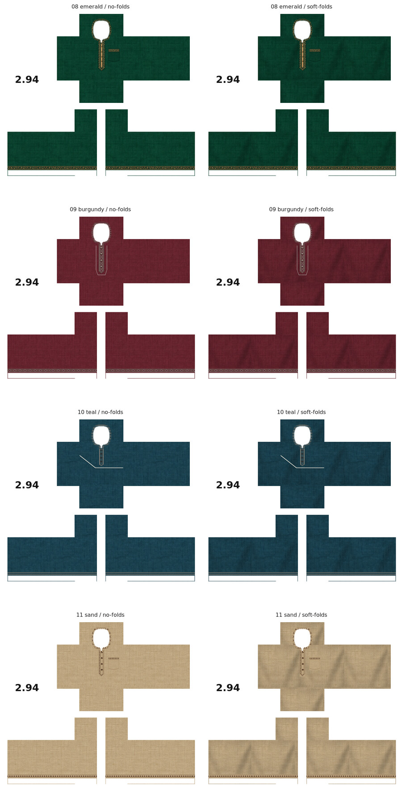
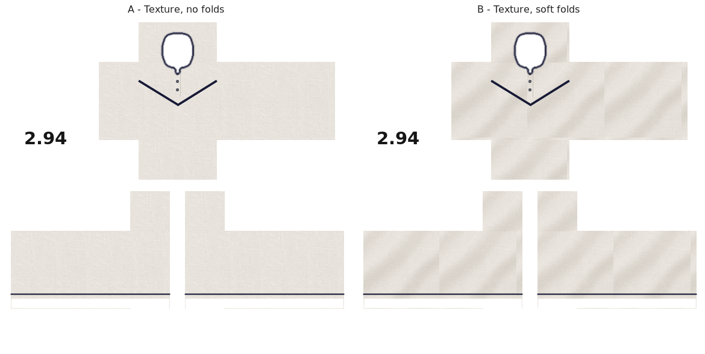
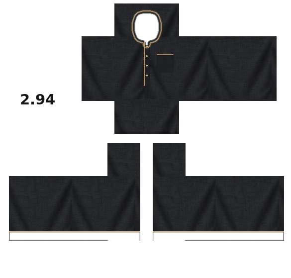
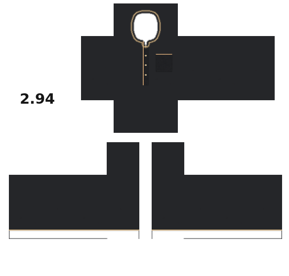
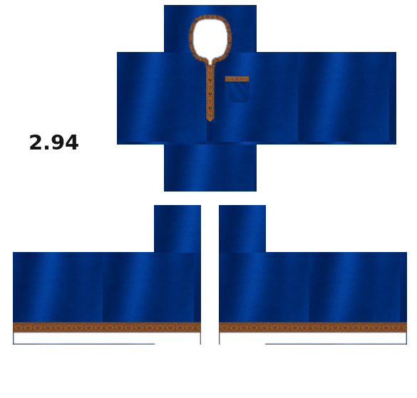
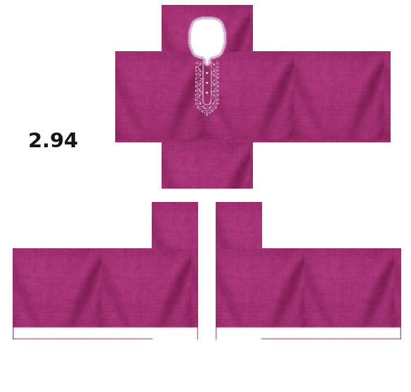

# Roblox Panjabi samples

## Four original designs: 08–11

[Browse all four designs and both fabric variants](original-collection-08-11/README.md) · [Download all eight PNGs as ZIP](original-collection-08-11/four-original-panjabi-designs-08-11.zip)

Original designs created without a supplied garment reference: emerald/gold botanical with pocket; burgundy/silver geometric with framed placket; teal/ivory modern asymmetric chest line; sand/chocolate Kantha-style stitching with pocket. Each has a textured no-fold version and a textured soft-fold version. All eight retain the approved 585 × 559 mapping, actual alpha cutouts, white unused background and `2.94` logo.

Dimensions and exact alpha equality with approved Sample03 were checked for all eight PNGs, as well as ZIP integrity. No Studio avatar testing has been performed. The comparison is a preview, not a wearable texture.

## Sample 07: Ivory and navy — two fabric variants

Same reference design in two separate wearable PNG files:

- [A: woven texture, no folds](panjabi-ivory-navy-sample-07-no-folds.png)
- [B: woven texture, gentle folds](panjabi-ivory-navy-sample-07-soft-folds.png)

Off-white/ivory matte cotton, navy neckline border, a navy V-shaped chest stripe, three small dark buttons with a subtle white placket stitch, and thin navy sleeve-end borders. No pocket in this reference. Both variants retain identical design positions and the approved 585 × 559 panel layout/alpha mask. Real alpha equality with Sample03 was checked for both exports. Fabric weave remains visible in both, while version B adds restrained diffuse fold shading without glossy highlights.

Verification previews (flattened, not wearable textures): [A alpha proof](previews/sample-07-alpha-no-folds.png) · [B alpha proof](previews/sample-07-alpha-soft-folds.png). Not tested on an avatar in Roblox Studio.

**Current user preference:** by default, make TWO separate PNGs of each new design: woven cloth with no large folds, and the same design with woven cloth plus soft folds. No-folds must still have visible fabric detail; do not flatten it into a solid background. Both variants should avoid shiny reflections. If the user explicitly requests one sample, deliver only one. Push the completed PNGs into this folder.

## Sample 06: Textured charcoal correction

[Download the actual shirt PNG](panjabi-textured-charcoal-sample-06.png)

Corrects Sample05, whose cloth was flattened too much and appeared to be a plain dark background. The intended preference is visible woven fabric and soft natural folds, with restrained diffuse shading and no glossy reflections or bright specular bands. Do not remove textile detail to remove shine.

The black cloth was regenerated using the approved magenta fabric as a texture reference, retaining woven grain and natural creases in a matte charcoal palette. Placket, four buttons, pocket, beige collar/cuff piping, logo and 585 × 559 layout are retained. Placket and pocket pixel regions are unchanged from Sample05; the real PNG alpha channel is identical to the approved Sample03. Plain-cloth brightness now has visible variation (roughly 25–46 for its 1st–99th percentiles on an 8-bit scale), instead of the nearly uniform previous version.

[Alpha proof](previews/sample-06-alpha-proof.png) · [Template overlay](previews/sample-06-overlay-check.png). These are flattened inspection previews, not wearable textures. Studio testing has not been performed.

## Sample 05: Matte charcoal with beige piping

[Download the actual shirt PNG](panjabi-matte-charcoal-sample-05.png)

Inspired by the supplied black Panjabi: matte charcoal cotton, fine beige/champagne-gold collar piping, a narrow placket with four small ivory-gold buttons, a chest pocket on the wearer's left with matching top piping, and fine piping around both sleeve ends. No embroidery or broad gold cuff bands in this reference.

The user requested matte cloth after finding the royal-blue sample's baked reflections distracting. This draft flattened the cloth excessively (about one 8-bit level of brightness variation) and was rejected for missing fabric detail. Use Sample06 for the corrected charcoal version. Future cloth must retain visible woven texture and gentle natural folds while avoiding glossy reflections.

585 × 559 RGBA; alpha is pixel-for-pixel identical to the approved Sample03. White background and `2.94` logo retained. Neckline, sleeves and all panel positions retain the approved mapping. Dimension, alpha, background and matte-cloth checks passed. Not tested on an avatar in Roblox Studio.

Verification previews (not wearable textures): [alpha proof](previews/sample-05-alpha-proof.png) · [template overlay](previews/sample-05-overlay-check.png).

## Sample 04: Royal blue and antique gold

[Download the actual shirt PNG](panjabi-royal-blue-sample-04.png)

Based on the user's royal-blue Panjabi reference: blue fabric, antique gold/copper embroidered collar and narrow pointed chest placket, a pocket on the wearer's left chest with matching embroidered top trim, and matching cuff embroidery wrapping around all four faces of both sleeves.

585 × 559 RGBA PNG. The garment panel layout and alpha channel are preserved from the approved magenta Sample 03. White unused background and black `2.94` branding remain. Only the neck and hand/sleeve openings are transparent. The rendered embroidery artwork was fitted onto the fixed clothing panel coordinates.

Verification: dimensions and pixel-for-pixel alpha equality with approved Sample 03 passed; both sleeve cuff strips and pocket trim contain the gold ornament. Alpha compositing and template-overlay previews were also produced. Not yet tested in Roblox Studio.

Verification previews (flattened, not wearable shirt textures):
- [Alpha proof](previews/sample-04-alpha-proof.png): cyan behind the shirt shows through its real transparent openings.
- [Template overlay](previews/sample-04-overlay-check.png): guide rectangles appear only in this inspection preview.

## Sample 03: Approved magenta and silver

[Download the actual shirt PNG](panjabi-magenta-sample-03.png)

Approved by the user as the layout and transparency master for future designs. 585 × 559 RGBA with white background and `2.94` branding. Magenta-purple fabric, smaller pale-silver chest ornament and four buttons. Neck and sleeve/hand alpha transferred from the approved red demo (image 71.png), resized to 585 × 559, with exact alpha equality verified. Fully transparent neckline bounds x273–316, y29–84 cross the UP/FRONT seam. No template outlines in the actual PNG.

[Alpha proof](previews/sample-03-alpha-proof.png) · [Template overlay](previews/sample-03-overlay-check.png)

## Earlier drafts

- [Sample 01](panjabi-magenta-sample-01.png): original generated draft; rejected for layout/background issues.
- [Sample 02](panjabi-magenta-sample-02.png): earlier fixed-size revision; use approved Sample 03 instead.

Keep future designs in this folder with sequential filenames, retaining the approved Sample 03 layout/alpha unless the user requests a change. Download the actual PNG files for clothing; do not use screenshots or flattened verification previews.
