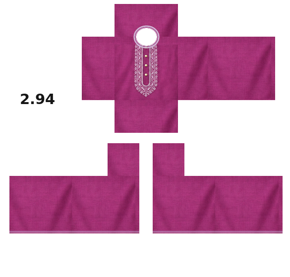

# Roblox Panjabi samples

## Current revision: Sample 02

[Download Sample 02](panjabi-magenta-sample-02.png)

585 × 559 RGBA PNG laid out on the Roblox Classic Shirt panel coordinates. Magenta-purple fabric and pale silver/lilac chest embroidery with four small ivory-gold buttons, inspired by the supplied real-life Panjabi photograph.

Changes requested by the user:
- White opaque background outside mapped garment panels, with a black `2.94` brand mark in unused space.
- No black template outlines or guide grid. Fabric fills the mapped faces and narrow internal torso/shoulder gutters.
- Rounded transparent neck opening centered on the UP/FRONT junction, extending into both faces.
- Small transparent hand-exposure strips across all sleeve side faces and transparent arm DOWN faces. Remaining garment areas are opaque.

The generated artwork was assembled onto the fixed template coordinates for export. Pixel checks confirm dimensions, alpha cutouts, opaque cloth coverage, and white background. Not yet tested on a character in Roblox Studio.

## Previous draft: Sample 01

[Original generated concept](panjabi-magenta-sample-01.png), 1283 × 1226 pixels. Retained for history; superseded by Sample 02 after feedback about panel gaps, outlines, background and neckline placement. Use Sample 02 for the revised template.

Future generated Panjabi samples from this conversation belong in this folder with sequential filenames.
