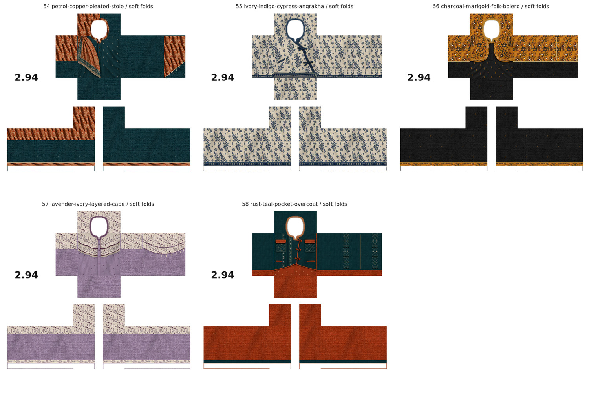
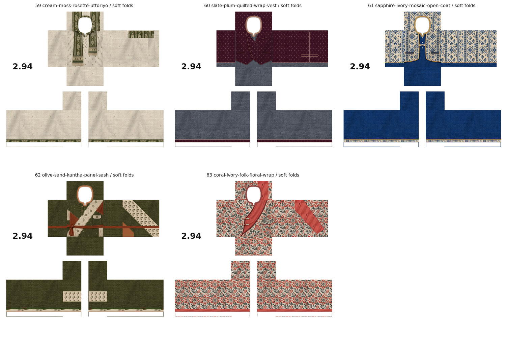

# Ten original layered Panjabi designs: 54–63

Ten distinct original styles. ONE textured soft-fold PNG per design; no no-fold duplicates.

[Download all ten PNGs](ten-original-layered-panjabi-designs-54-63.zip) · [View all ten together](ten-layered-designs-preview.jpg)

| Design | Download actual PNG | Clothing details |
| --- | --- | --- |
| 54 | [পেট্রোল ও কপার প্লিটেড স্টোল](panjabi-54-petrol-copper-pleated-stole.png) | Petrol cotton, copper paisley stole with shoulder pleats, wooden pin, tapered fringe and matching shoulder/back continuation. |
| 55 | [আইভরি ও ইন্ডিগো সাইপ্রেস আংরাখা](panjabi-55-ivory-indigo-cypress-angrakha.png) | All-over cypress botanical print, indigo crossover binding, side bow ties, small pocket and patterned hem/cuffs. |
| 56 | [চারকোল ও মেরিগোল্ড ফোক বোলেরো](panjabi-56-charcoal-marigold-folk-bolero.png) | Cropped ochre floral koti with cream mirror-work discs and braided clasp over charcoal buti cotton. |
| 57 | [ল্যাভেন্ডার ও আইভরি দুই স্তরের কেপ](panjabi-57-lavender-ivory-layered-cape.png) | Two scalloped Kantha shoulder tiers with plum edging, short fringe and matching back/shoulder caps. |
| 58 | [রাস্ট ও টিল পকেট ওভারকোট](panjabi-58-rust-teal-pocket-overcoat.png) | Asymmetric teal utility coat, rust-flap chest pockets, wooden toggles, pleated stripe and stitched back panels. |
| 59 | [ক্রিম ও মস-গ্রিন রোজেট উত্তরীয়](panjabi-59-cream-moss-rosette-uttoriyo.png) | Cream leaf-buti kurta, unequal green Jamdani-style almond/rosette stole ends, woven borders and fringe. |
| 60 | [স্লেট ও প্লাম কুইল্টেড র‍্যাপ ভেস্ট](panjabi-60-slate-plum-quilted-wrap-vest.png) | Diamond-quilted plum wrap waistcoat, cloth buttons, copper piping, slit pockets and slate underlayer. |
| 61 | [স্যাফায়ার ও আইভরি মোজাইক কোট](panjabi-61-sapphire-ivory-mosaic-open-coat.png) | Open ivory/indigo mosaic coat over sapphire cotton, ochre lapel piping, braided clasp and welt pockets. |
| 62 | [অলিভ ও স্যান্ড কাঁথা প্যানেল ও স্যাশ](panjabi-62-olive-sand-kantha-panel-sash.png) | Bold cream/olive/rust panelwork, handmade stitch rows, flap pocket and rust waist sash continuing around torso. |
| 63 | [কোরাল ও আইভরি ফ্লোরাল র‍্যাপ](panjabi-63-coral-ivory-folk-floral-wrap.png) | Airy coral/charcoal botanical linen, broad coral crossover panel, burgundy binding, braided closures and patch pocket. |

All wearable PNGs are 585 × 559, 8-bit RGBA with approved Sample03 panel mapping and pixel-identical real alpha openings. White unused canvas and 2.94 branding retained. No template guide outlines or painted checkerboard. Drapes, coats, capes, vests and sashes are rendered within the Classic Shirt texture.

Matte fabric detail uses matching cotton/linen material scans, color-matched to each source and softly shaded, retaining visible weave even on dark cloth. Botanical prints, rosettes, borders and layered artwork continue on back, shoulder, side and sleeve faces as appropriate. Front fastenings and pockets are kept off the back.

Verified dimensions, exact alpha equality, actual neck/hand cutouts, white canvas, branding, visible sleeve fabric variation, preview sizes, unique outputs and ZIP integrity. No Roblox Studio avatar testing performed. Upload the individual PNGs, not the flattened JPG previews.
