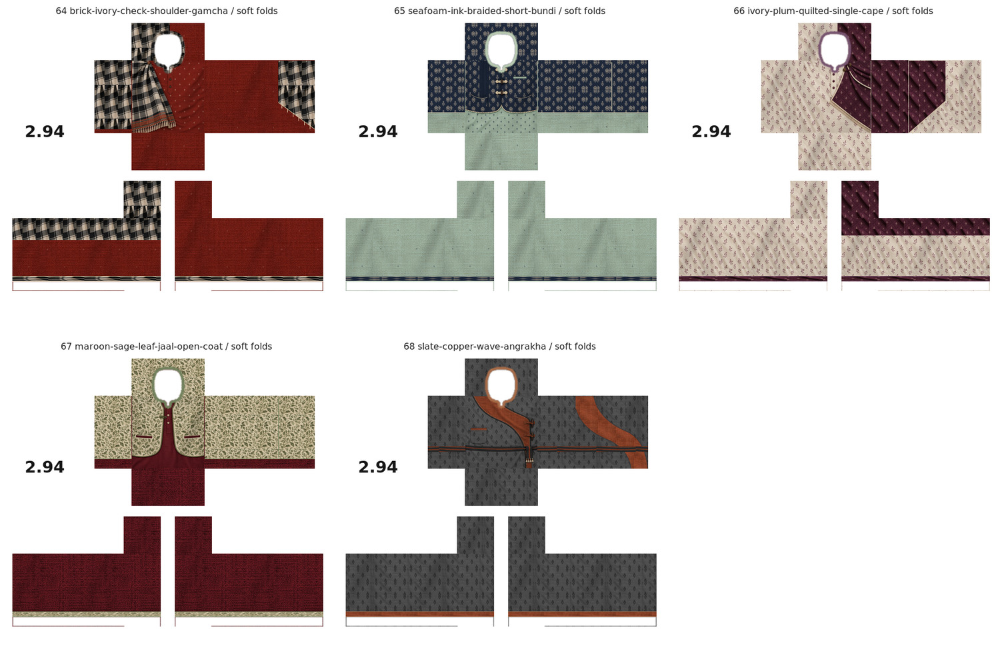
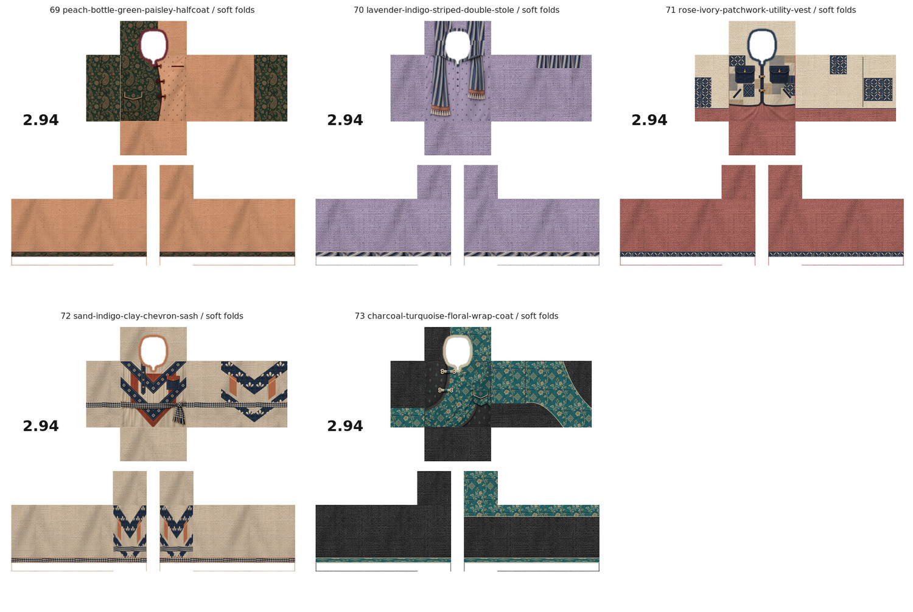

# Ten original layered Panjabi designs: 64–73

Ten distinct original styles. ONE textured soft-fold PNG per design; no no-fold duplicates.

[Download all ten PNGs](ten-original-layered-panjabi-designs-64-73.zip) · [View all ten together](ten-layered-designs-preview.jpg)

| Design | Download actual PNG | Clothing details |
| --- | --- | --- |
| 64 | [ব্রিক ও কালো-আইভরি গামছা](panjabi-64-brick-ivory-check-shoulder-gamcha.png) | Brick cotton, black/ivory checked shoulder gamcha, wood pin, copper end border, ivory fringe and matching shoulder/back drape. |
| 65 | [সিফোম ও ইঙ্ক ছোট বুন্দি](panjabi-65-seafoam-ink-braided-short-bundi.png) | Seafoam buti kurta under a cropped navy rosette bundi, three braided cream closures, wooden toggles, pleated strip and scalloped hem. |
| 66 | [আইভরি ও প্লাম এক কাঁধের কেপ](panjabi-66-ivory-plum-quilted-single-cape.png) | Ivory plum-sprig cotton with a one-shoulder quilted plum cape, small clasps, pale binding and short angled fringe. |
| 67 | [মেরুন ও সেজ পাতার কোট](panjabi-67-maroon-sage-leaf-jaal-open-coat.png) | Maroon kurta under open ivory/sage leaf-jaal coat, soft lapels, green binding, braided loop and maroon-edged welt pockets. |
| 68 | [স্লেট ও কপার ঢেউখেলানো আংরাখা](panjabi-68-slate-copper-wave-angrakha.png) | Grey ikat cotton with copper S-shaped wrap panel, cream Kantha stitches, wooden loop toggles, small pocket and dark cloth waist sash. |
| 69 | [পিচ ও বটল-গ্রিন পেইসলি হাফ-কোট](panjabi-69-peach-bottle-green-paisley-halfcoat.png) | Peach buti kurta with a single green paisley coat panel, burgundy knotted fastenings, wooden toggles and large flap pocket. |
| 70 | [ল্যাভেন্ডার ও ইন্ডিগো ডোরাকাটা স্টোল](panjabi-70-lavender-indigo-striped-double-stole.png) | Lavender seed-buti cotton with two striped stole ends, rust geometric end borders, uneven lengths, soft top loop and fringe. |
| 71 | [রোজ ও আইভরি প্যাচওয়ার্ক ইউটিলিটি ভেস্ট](panjabi-71-rose-ivory-patchwork-utility-vest.png) | Rose cotton with ivory/navy handloom patchwork vest, large dark flap pockets, wood toggles and stitched back patch panels. |
| 72 | [স্যান্ড ও ইন্ডিগো চেভরন স্যাশ](panjabi-72-sand-indigo-clay-chevron-sash.png) | Sand/indigo/clay chevron panels, folk rosettes, off-center placket, flap pocket, checked waist sash, knot and matching sleeve panels. |
| 73 | [চারকোল ও টারকোয়েজ ফ্লোরাল র‍্যাপ](panjabi-73-charcoal-turquoise-floral-wrap-coat.png) | Charcoal teal-buti cotton with a turquoise flowering wrap panel, curved binding, ivory braided fastenings and angular flap pocket. |

All wearable PNGs are 585 × 559, 8-bit RGBA with approved Sample03 panel mapping and pixel-identical real alpha openings. White unused canvas and 2.94 branding retained. No template guide outlines or painted checkerboard. Drapes, coats, capes, vests and sashes are rendered within the Classic Shirt texture.

Matte fabric detail uses matching cotton/linen material scans, color-matched to each source and softly shaded, retaining visible weave even on dark cloth. Botanical prints, rosettes, borders and layered artwork continue on back, shoulder, side and sleeve faces as appropriate. Front fastenings and pockets are kept off the back.

Verified dimensions, exact alpha equality, actual neck/hand cutouts, white canvas, branding, visible sleeve fabric variation, preview sizes, unique outputs and ZIP integrity. No Roblox Studio avatar testing performed. Upload the individual PNGs, not the flattened JPG previews.
