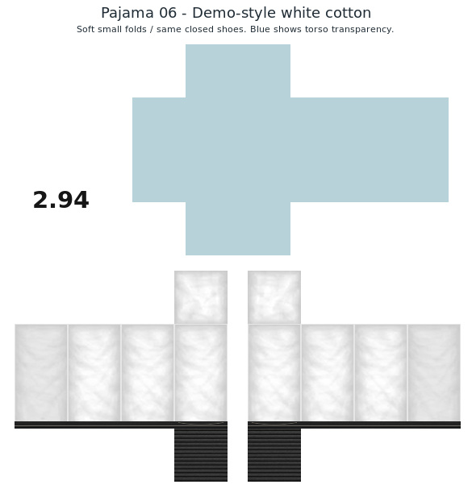

# Pajama 06 — demo-style white cotton

One plain white pajama with small, soft rounded folds and pale gray shadows, following the supplied white-fabric demonstration. The same closed black shoes and ribbed soles from the previous version are retained exactly. No embroidery or extra decoration.

- [Wearable PNG](pajama-06-demo-white-soft-shading-with-shoes.png)
- [PNG, preview and README in ZIP](pajama-06-demo-white-with-shoes.zip)

Upload the PNG as **Roblox Classic Pants**. It is **585 × 559**, 8-bit RGBA. Legs and foot soles are fully covered; the torso is truly transparent. Unused canvas stays white with **2.94** branding. Blue in the preview only indicates torso transparency.

The native panel shading follows the supplied white demo, combined with a small contribution from a generated matching cotton source. The large vertical folds of the earlier white versions have been replaced with the reference's smaller horizontal and diagonal fold shapes.

Verified dimensions, alpha, opaque feet, exact shoe pixel preservation, neutral white cloth and visible fold variation. Not tested on an avatar in Roblox Studio.
