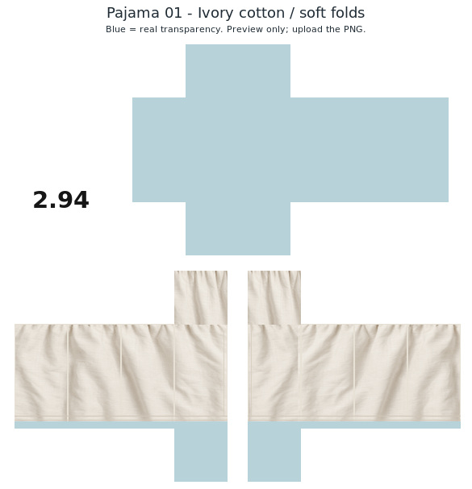

# Pajama sample 01 — ivory cotton

One simple off-white Bengali pajama texture for Roblox Classic Pants, with fine matte cotton weave, gentle folds and double-stitched ankle hems.

## Download and use

- Upload **pajama-01-ivory-cotton-soft-folds.png** as **Classic Pants**.
- The wearable PNG is exactly **585 × 559**, 8-bit RGBA.
- All six torso faces are genuinely transparent. There is no shirt neckline or chest artwork.
- All eight leg side faces and both upper thigh caps have cloth. The last nine pixels below each hem and the two sole faces are transparent to expose bare feet. Shoes are not included.
- Unused canvas is opaque white with the requested **2.94** branding.
- Blue in the JPEG preview shows transparent areas; it is not printed in the wearable PNG.
- The ZIP includes the wearable PNG, preview and this README.

The supplied Pants template and three demonstrations were inspected for panel placement. Textile artwork is newly generated; creator branding and template guide lines from the demonstrations were not copied.

Checked native dimensions, RGBA depth, torso/foot transparency, covered leg faces, visible textile variation and ZIP integrity. Not tested on an avatar in Roblox Studio.
