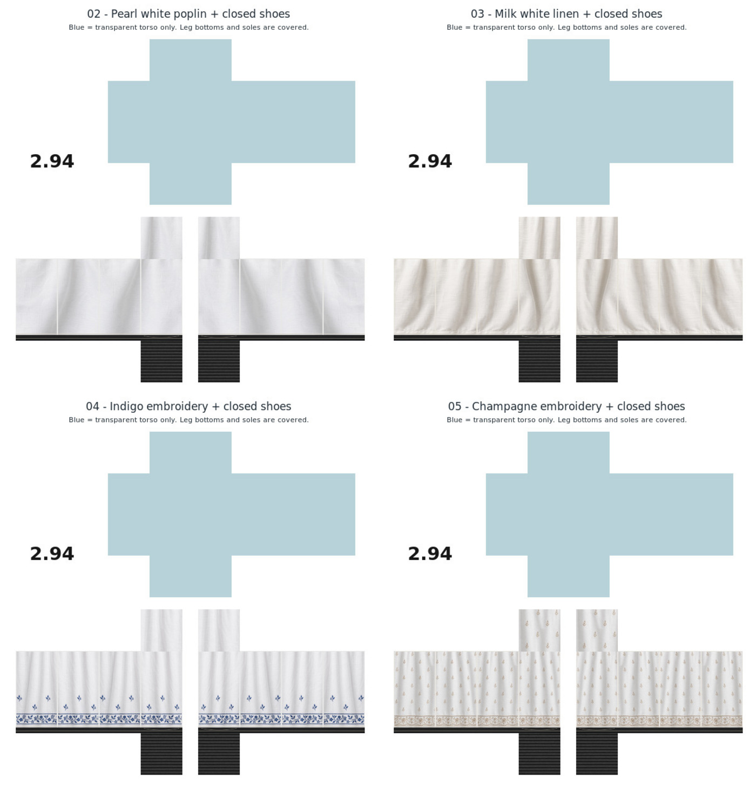

# Four white pajamas — corrected with closed footwear

These are the corrected versions of samples 02–05. Opaque black loafer-style uppers and textured rubber soles now cover the previously transparent ankle and foot-bottom regions. The approved white fabric, folds and embroidery are unchanged.

| Sample | Style | Wearable PNG |
| --- | --- | --- |
| 02 | Simple pearl-white poplin with shoes | [PNG](pajama-02-pearl-white-poplin-with-shoes.png) |
| 03 | Simple milk-white linen with shoes | [PNG](pajama-03-milk-white-linen-with-shoes.png) |
| 04 | White with indigo botanical embroidery and shoes | [PNG](pajama-04-white-indigo-botanical-with-shoes.png) |
| 05 | White with champagne floral embroidery and shoes | [PNG](pajama-05-white-champagne-chikankari-with-shoes.png) |

[Download all four corrected designs](four-white-pajamas-02-05-with-shoes.zip).

Upload the wearable PNGs as **Roblox Classic Pants**. Each is **585 × 559**, 8-bit RGBA. All leg side faces, thigh caps and foot soles are opaque. The torso remains genuinely transparent. Unused canvas stays white with **2.94** branding. Blue in the preview indicates transparent torso regions; it is not printed on the PNG.

The ZIP contains four wearable PNGs, four individual JPEG previews, the combined preview and this README. Pixel checks confirm every region outside the added footwear matches its previous approved PNG exactly. Foot coverage, torso transparency, native dimensions and ZIP integrity were verified. No Roblox Studio avatar test was performed.
