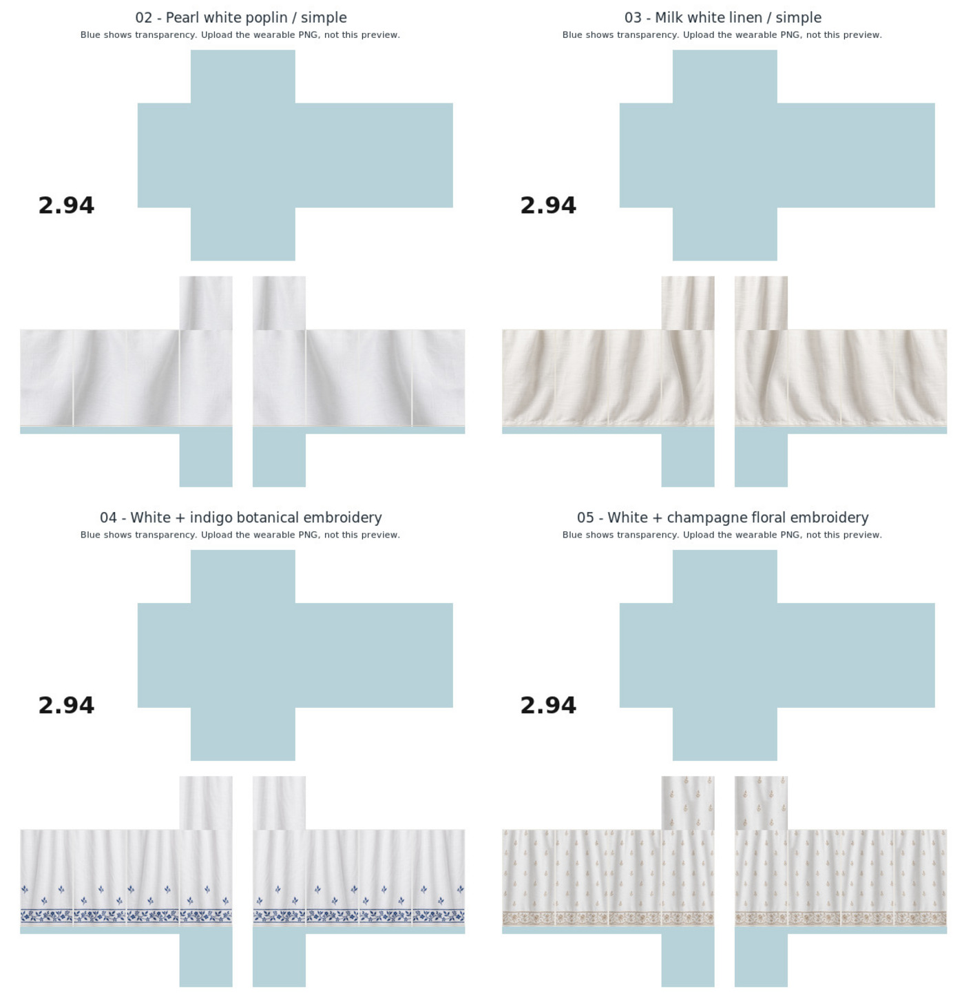

# Four white pajama designs — samples 02–05

Four new Roblox Classic Pants textures: two simple white cotton designs and two embroidered white designs. One soft-fold wearable PNG per design.

| Sample | Design | Wearable PNG |
| --- | --- | --- |
| 02 | Simple pearl-white poplin, gentle broad folds | [PNG](pajama-02-pearl-white-poplin.png) |
| 03 | Simple milk-white cotton-linen, relaxed gathered folds | [PNG](pajama-03-milk-white-linen.png) |
| 04 | White cotton with indigo botanical ankle embroidery and sparse leaf sprigs | [PNG](pajama-04-white-indigo-botanical.png) |
| 05 | White cotton with champagne floral buti and embroidered ankle border | [PNG](pajama-05-white-champagne-chikankari.png) |

[Download the complete ZIP](four-white-pajamas-02-05.zip).

Upload the **wearable PNG** as **Classic Pants**. Each is585×559, 8-bit RGBA, matching the approved sample01 Pants alpha mask exactly. All torso faces and bare-foot areas are genuinely transparent; all leg cloth faces and thigh caps are covered. Unused canvas stays white with2.94 branding. No footwear included.

Blue areas in the preview show transparency; blue is not part of the wearable texture. The ZIP includes four wearable PNGs, four individual JPEG previews, the combined preview and this README.

Validated native dimensions, RGBA8, exact alpha equality to approved sample01, covered leg panels, real torso/foot cutouts, textile variation, distinct designs, retained blue embroidery and ZIP integrity. Not tested on an avatar in Roblox Studio.
